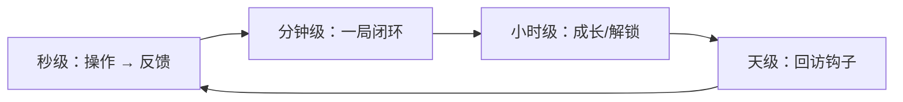

# 核心循环设计表 · <游戏名>

## 1. 乐趣原子

`玩家每 ___ 秒通过 ___ 操作获得 ___ 快感。`

三问自检：
- 去掉奖励还爽吗：是 / 否
- 换题材还成立吗：是 / 否（是 = 机制驱动）
- 一局内出现次数：___ 次

## 2. 三层循环

| 层 | 时长 | 内容 | 目标指标 |
|---|---|---|---|
| 秒级 | | | |
| 分钟级 | | | |
| 小时级 | | | |
| 天级 | | | |

## 3. 单局情绪曲线

| 阶段 | 时间 | 玩家状态 | 设计手段 |
|---|---|---|---|
| 起 | 0–5s | 看懂目标 | |
| 紧 | | 压力上升 | |
| 松 | | 喘息 | |
| 爽 | | 结算峰值 | |
| 余 | | 想再来一局 | |

## 4. 数值反推

| 变量 | 取值 | 依据 |
|---|---|---|
| 目标单日时长 T | | |
| 单局时长 t | | |
| 日均局数 N=T/t | | |
| 单局产出 r | | |
| 升级所需 C | | |
| 首日升级次数 K | | 快爽 8–15 / 标准 3–8 / 慢养 1–3 |

## 5. 留存钩子

| 类型 | 具体设计 | 触发时机 | 强度 | 反感风险 |
|---|---|---|---|---|
| 进度 | | | | |
| 收集 | | | | |
| 社交 | | | | |
| 损失 | | | | |

## 6. 广告/付费映射

| 玩家痛点 | 广告位 | 内购点 | 频次上限 |
|---|---|---|---|
| 想省时间 | | | |
| 想降难度 | | | |
| 想变强/变好看 | — | | |
| 想补资源 | | | |

## 7. 首日体验目标

- 第 1 局结束应有：___
- 首次广告曝光时机：第 ___ 局后
- 首次授权弹窗时机：___
- 首日预期留存：___%（行业区间参考，不作承诺）
