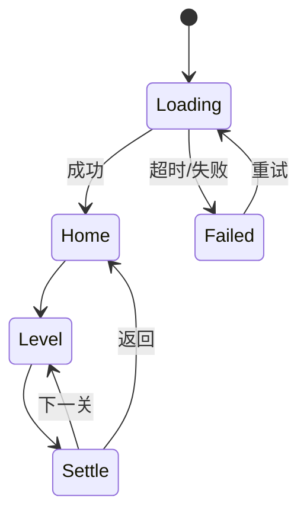

# 游戏开发规格说明书 · <游戏名>

版本：v0.1 ｜ 日期：____ ｜ 策划：____ ｜ 面向：程序 / 美术 / 测试

## 1. 项目概述

- 一句话玩法：
- 平台与形态：微信小游戏（Canvas/WebGL）
- 屏幕方向：
- 目标上线时间：
- 本版范围：P0 全量 / P1 部分（列出）

## 2. 核心循环与数值

循环图见 `core-loop-table.md`。以下为程序直接消费的数据：

```csv
level,mechanism,timeLimit,obstacleDensity,maxMistake,rewardCoin,rewardItem
1,jump,60,low,3,50,
```

规则说明：
- 容错次数用尽即判负。
- 奖励结算在成功动画结束后一次性发放，避免重复领取。

## 3. 功能清单

| ID | 模块 | 功能 | 优先级 | 备注 |
|---|---|---|---|---|
| F01 | 主流程 | 开始游戏 | P0 | |
| F02 | 关卡 | 关卡加载与结算 | P0 | |
| F03 | 广告 | 激励视频（复活/双倍） | P0 | 失败兜底必做 |
| F04 | 排行 | 好友排行榜（开放数据域） | P1 | |

## 4. 界面与交互

### 4.1 页面清单

| 页面 | 入口 | 出口 | 四态是否齐全 |
|---|---|---|---|
| 主界面 | 启动 | 关卡/设置/排行 | |
| 关卡 | 主界面 | 结算 | |
| 结算 | 关卡结束 | 下一关/主界面 | |
| 设置 | 主界面 | 返回 | |

### 4.2 状态机



异常态要求：每个页面必须定义加载中、空态、失败态、边界态（资源上限/满级/次数用尽）的文案与按钮。

## 5. 数据与存档

| 字段 | 类型 | 默认值 | 说明 |
|---|---|---|---|
| level_max | int | 1 | 解锁的最高关 |
| coin | int | 0 | 金币 |
| ad_count_today | int | 0 | 当日广告次数（用于频控） |
| last_login | string | "" | 用于离线收益判定 |

存档策略：本地为主 + 云存档（若启用需说明冲突处理：取较新，保留备份）。

## 6. 广告与支付

| 触发点 | 类型 | 奖励 | 频次上限 | 失败兜底 |
|---|---|---|---|---|
| 失败复活 | 激励视频 | 原地复活 1 次 | 每局 1 次 | 直接给一次复活 |
| 结算翻倍 | 激励视频 | 金币 x2 | 每局 1 次 | 按 1 倍发放并提示 |
| 关卡间 | 插屏 | — | 每 2–3 局 1 次，间隔 ≥60s | 跳过不报错 |

无版号时：支付模块只留接口定义，界面不出现任何付费入口。

## 7. 验收标准

```markdown
[ ] 新用户从启动到完成第 1 局 ≤ 60 秒，无强制授权
[ ] 四态齐全，断网不白屏
[ ] 弱网（3G / 丢包 20%）可完成一局
[ ] 低端机帧率 ≥ ___ fps
[ ] 广告加载失败有兜底，玩家不卡死
[ ] 杀进程后存档不丢失
[ ] 无调试入口、无测试文案、无内网地址
[ ] 包体符合平台限额（以最新文档为准）
```

## 8. 变更记录

| 日期 | 变更 | 原因 | 影响 | 确认人 |
|---|---|---|---|---|
| | | | | |
