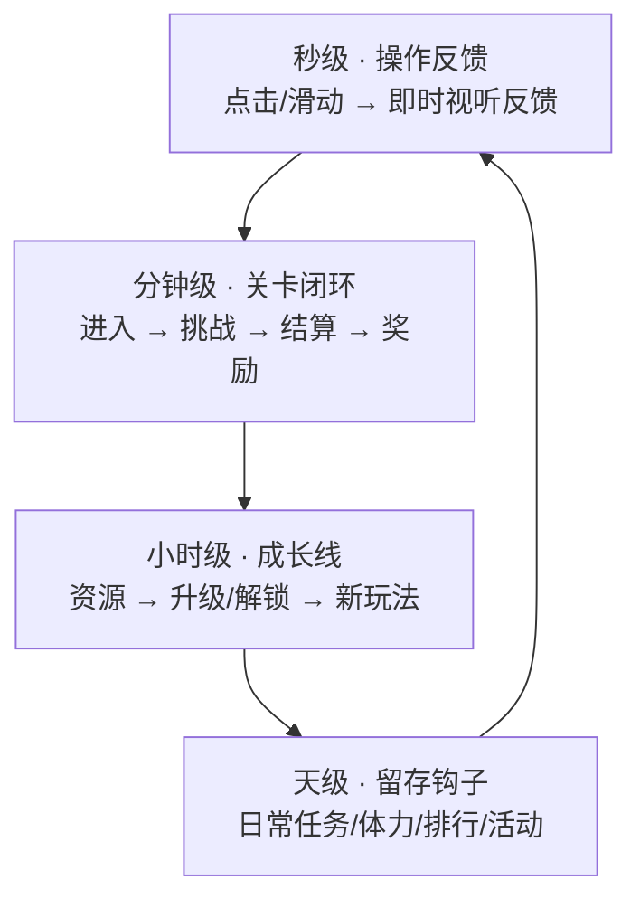

# 阶段 1 · 核心循环与留存付费

核心循环不是流程图装饰，它是"玩家为什么会在第 3 分钟、第 3 天、第 30 天回来"的答案。写不出三层循环，说明玩法还没立住。

## 一、先写乐趣原子

格式：`玩家每 <时长> 通过 <操作> 获得 <可感知的快感>`。

合格例：`玩家每 8 秒通过一次精准跳跃越过障碍，获得"我控住了"的节奏快感`。
不合格例：`玩家通过闯关获得快乐`（无法验证、无法落数值）。

检验三问：
1. 去掉奖励后，这个操作本身还爽吗？
2. 换个题材，这套操作还成立吗？（成立说明乐趣来自机制而非皮）
3. 一局 60 秒内能体验到几次这个原子？（少于 3 次，节奏偏慢）

## 二、三层循环



| 层 | 时长 | 负责什么 | 关键指标 | 常见错误 |
|---|---|---|---|---|
| 秒级 | 0.5–3 秒 | 手感与反馈 | 操作响应延迟、打击感 | 反馈延迟 > 100ms，或只有数值没有视听 |
| 分钟级 | 30–180 秒 | 一局的完整情绪曲线 | 单局完成率、重开率 | 单局过长，小游戏碎片场景撑不住 |
| 小时级 | 1–3 小时 | 成长与解锁 | 首日解锁率 | 成长线做成纯数值膨胀 |
| 天级 | 1–30 天 | 回访理由 | 次留、7 留 | 钩子全靠签到，无玩法驱动 |

## 三、单局情绪曲线（分钟级）

一局要有"起—紧—松—爽—余"：

1. **起**（0–5 秒）：一屏内看懂目标，不需教程文字。
2. **紧**（上升段）：难度递增或资源收紧，制造"要输了"的错觉。
3. **松**（喘息点）：一次小奖励或安全区，避免持续高压。
4. **爽**（结算爆点）：结算动画 + 音效 + 数字跳动，是本局的情绪峰值。
5. **余**（钩子）：差一点的进度条、"再来一次更近"的提示。

## 四、数值反推法

不要先定数值再算时长，先定时长再反推：

```
目标单日时长 T（休闲小游戏常见 8–20 分钟）
单局时长 t（30–120 秒）
日均局数 N = T / t
单局产出 r → 日产出 R = N × r
升级所需资源 C → 首日升级次数 K = R / C（K 取 3–8 较舒适）
```

三档节奏建议：

| 节奏 | 首日升级次数 | 适用 |
|---|---|---|
| 快爽型 | 8–15 | 超休闲，靠广告变现，重首日体验 |
| 标准型 | 3–8 | 中度休闲，广告 + 轻内购 |
| 慢养型 | 1–3 | 有长线成长与剧情，靠留存换 LTV |

## 五、留存钩子四类

1. **进度钩子**：差一点就完成（进度条 80% 停手最难受）。
2. **收集钩子**：图鉴/角色/皮肤缺口可视化。
3. **社交钩子**：好友排行、助力、PK（注意分享合规边界，见 monetization）。
4. **损失钩子**：离线收益、限时活动、连续奖励（慎用恐吓式文案）。

每类钩子标注：触发时机、强度（弱/中/强）、是否会引发反感。

## 六、付费点与广告点映射

| 玩家心理 | 广告位 | 内购点 |
|---|---|---|
| 想省时间 | 激励视频：跳过等待/加速 | 加速道具 |
| 想降低难度 | 激励视频：复活/加一步 | 复活币、体力 |
| 想变强/变好看 | — | 皮肤、通行证、礼包 |
| 想补充资源 | 激励视频：双倍结算 | 资源包 |

原则：**广告解决"这一刻难受"，内购解决"长期想要"**。把长期价值塞进广告会让付费意愿归零；把即时救济做成付费墙会掉留存。

内购相关设计在无版号情况下只能标注为"接口预留、不启用"，详见 `monetization.md`。

## 七、输出模板

用 `assets/templates/core-loop-table.md`，必须包含：乐趣原子、三层循环图、单局曲线、数值反推表、钩子清单、广告/付费映射。
