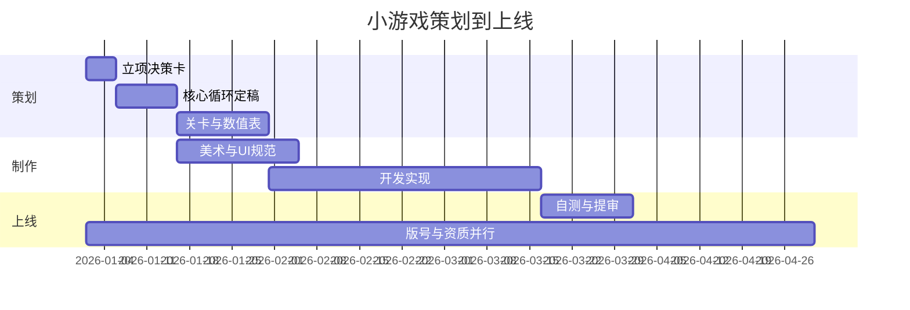

# 阶段 2 · 关卡与机制设计

关卡不是"把难度调高"，而是"用有限机制造出不同的问题"。先做机制矩阵，再排难度曲线，最后写角色行为。

## 一、机制清单与组合矩阵

列出核心机制（建议 3–6 条，超过 8 条小游戏难消化），两两做组合，标注"能出新题/同质/冲突"。

| 机制 A ＼ 机制 B | 跳跃 | 重力翻转 | 限时 | 传送门 |
|---|---|---|---|---|
| 跳跃 | — | 新题（高价值） | 新题 | 同质 |
| 重力翻转 | 新题 | — | 冲突（手感乱） | 新题 |
| 限时 | 新题 | 冲突 | — | 同质 |

判定标准：
- **新题**：组合后玩家的决策变了（不只是变快变难）。
- **同质**：只是难度加成，玩家策略不变。
- **冲突**：两条机制的输入或反馈互相干扰，慎用。

优先开发"新题"组合，同质组合留给后期做变奏，冲突组合直接砍。

## 二、难度曲线四段式

| 段 | 关卡数占比 | 目的 | 手法 |
|---|---|---|---|
| 教学 | 10–15% | 零文字教会操作 | 单一机制 + 安全环境 + 强反馈 |
| 变奏 | 30% | 同一机制换场景/参数 | 参数微调，不加新机制 |
| 叠加 | 40% | 机制组合，压力上升 | 每 3–5 关引入一个组合 |
| 考核 | 15% | 检验掌握度，制造高光 | 短时限、高密度、明确成败 |

每 5 关设一个"呼吸关"（明显简单），让玩家维持"我在变强"的体感。全程无呼吸关，流失集中在第 8–12 关。

失败率参考带：新手前 10 关单关失败率 < 20%；中期 25–45%；考核关 50–65%。超过 70% 的连续失败必须插入降难度或给救援道具。

## 三、关卡数值表结构

每关一行，字段固定，便于调参与验收：

| 关卡 | 机制 | 目标 | 时限(s) | 障碍密度 | 容错次数 | 预期失败率 | 奖励 |
|---|---|---|---|---|---|---|---|

"容错次数"是策划给程序的硬约束：超过即判负，避免手感模糊。

## 四、角色与 AI 行为系统

需要 NPC 语气/立场时，不要逐句写死台词，用参数谱驱动：

| 参数 | 取值 | 影响 |
|---|---|---|
| 情绪 valence | -1 ~ +1 | 用词褒贬、句子长度 |
| 唤醒度 arousal | 0 ~ 1 | 感叹号密度、语速（VO）、动作幅度 |
| 立场 stance | 支持 / 中立 / 反对 | 对玩家行为的评价方向 |
| 亲密距离 | 生疏 / 熟络 / 越界 | 称呼、敬语、玩笑尺度 |
| 权威度 | 0 ~ 1 | 命令句 vs 建议句 |

组合示例：`valence=+0.6, arousal=0.8, stance=支持, 亲密=熟络` → 短句 + 感叹 + 昵称 + 主动提议。
同一角色配 3–5 套"语气档"，配合剧情节点切换，表现力足够且可控。

禁止：让 NPC 输出未经审核的自由文本（内容安全风险，见 `compliance-review.md`）。

## 五、里程碑排期（甘特骨架）

要点：资质线（c2）从 Day 1 开始跑，与开发并行；不要把提审放在最后才想起版号。

## 六、输出物

- 机制组合矩阵（含取舍理由）
- 难度曲线表（关卡 × 失败率）
- 关卡数值表（可直接给程序配置）
- 角色语气档定义（若含 NPC）
- 里程碑甘特图
